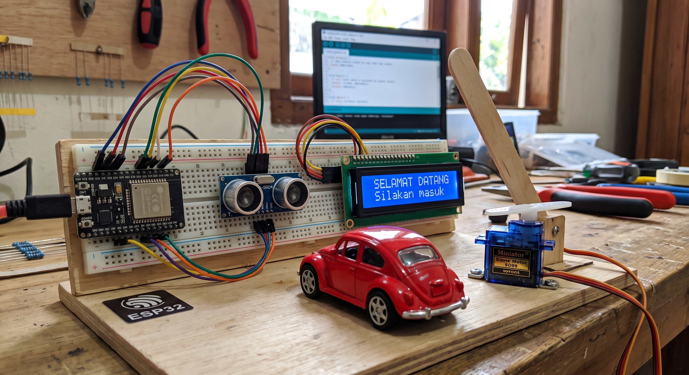
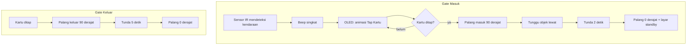

<div align="center">

# 🅿️ Smart Parkir — ESP32 RFID Gate System

**Sistem palang otomatis pintu masuk & pintu keluar berbasis RFID, dengan layar OLED ganda, sensor IR, buzzer, dan palang servo.**

[](https://www.espressif.com/)
[](https://www.arduino.cc/)
[](#-cara-build--flash)
[](LICENSE)

</div>

---

## 📸 Prototipe Fisik

<div align="center">

| Palang pintu & pembaca kartu |
| :---: |
|  |

</div>

---

## ✨ Fitur

- **Dua gate independen** — pintu masuk & pintu keluar, masing-masing dengan modul RC522 sendiri di satu bus SPI yang dibagi.
- **Gate masuk memeriksa:** kendaraan wajib terdeteksi sensor IR dulu (aktif LOW) → beep → animasi Tap Kartu di OLED → tap kartu → palang naik → tertutup otomatis 2 detik setelah objek lewat.
- **Gate keluar bebas:** tap kartu langsung → palang naik → tutup otomatis 5 detik.
- **Dua layar OLED** 0.96 inch I2C di dua bus I2C terpisah (Wire + Wire1) — layar sambutan di pintu masuk, layar tap di pintu keluar.
- **Buzzer konfirmasi** saat objek terdeteksi & kartu diterima.
- **Firmware diagnostik** — varian lengkap dengan self-test saat boot (buzzer, kedua palang, status semua modul) dan monitor [SCAN] tiap 3 detik untuk mengecek pengkabelan.

---

## 🧰 Komponen (BOM)

| Qty | Komponen | Catatan |
| :-: | --- | --- |
| 1 | NodeMCU ESP32 30 pin | terpasang Expansion Board 30P (header G-V-S + jumper selektor 3.3V/5V) |
| 2 | Modul RFID RC522 | versi kloning tetap berfungsi |
| 2 | OLED 0.96 inch I2C (SSD1306 128x64) | satu per gate |
| 2 | Servo SG90 | palang pintu |
| 1 | Sensor IR obstacle | deteksi kendaraan di gate masuk (LOW saat ada objek) |
| 1 | Buzzer aktif | pin digital biasa |
| 1 | Breadboard + kabel jumper M-F | jalur SPI paralel & distribusi daya |

---

## 🔌 Pin Map (ESP32 NodeMCU-32S)

| Fungsi | GPIO | Bus | Catatan |
| --- | :-: | --- | --- |
| SPI SCK | 18 | SPI (dibagi 2 RFID) | |
| SPI MISO | 19 | SPI (dibagi) | |
| SPI MOSI | 23 | SPI (dibagi) | diparalel via breadboard |
| SPI RST | 22 | SPI (dibagi 2 RFID) | |
| SS RFID masuk | 5 | | chip select gate masuk |
| SS RFID keluar | 4 | | chip select gate keluar |
| OLED masuk SDA | 26 | Wire (bus 1) | alamat 0x3C |
| OLED masuk SCL | 32 | Wire | |
| OLED keluar SDA | 21 | Wire1 (bus 2) | alamat 0x3C |
| OLED keluar SCL | 33 | Wire1 | |
| Sensor IR | 13 | | LOW = ada objek |
| Servo palang masuk | 12 | | GPIO12 = strapping pin (MTDI) |
| Servo palang keluar | 14 | | |
| Buzzer | 27 | | aktif HIGH |

**Daya:** RC522 dan OLED wajib 3.3V; servo dan IR ke rail 5V (lewat jumper expansion board).

---

## 🧠 Alur Logika



---

## 🏆 Catatan Engineering

Hal yang ditemukan **saat me-build dan me-debug hardware aslinya** — bukan hasil simulasi:

1. **Dua RC522 di satu bus SPI** — empat garis SPI (SCK/MOSI/MISO/RST) dibagi lewat breadboard, satu kolom per sinyal; hanya SS (chip select) yang dipisah per gate.
2. **Deteksi chip kloning** — salah satu RC522 melaporkan `0x82` (bukan firmware vendor asli 0x9x); kode menerimanya dan tetap berjalan normal. Nilai `0x00/0xFF` = ada masalah pengkabelan SPI atau daya.
3. **`begin()` OLED bisa berhasil palsu** — status OK meski modul tidak ada; versi diagnosa menambahkan cek ACK lewat `Wire/Wire1.endTransmission()` untuk memisahkan masalah kabel vs modul mati.
4. **Dua OLED di dua bus I2C terpisah** — `Wire1` dipakai supaya tidak menumpuk di bus yang sama; pin SDA/SCL tiap bus didefinisikan sendiri.
5. **GPIO12 adalah pin strapping (MTDI)** — berisiko memengaruhi boot jika tertarik HIGH saat power-on; perhatian ekstra saat servo dipasang di sini.
6. **Servo di rail 3.3V menyebabkan drop tegangan dan serial acak** — servo dipindah ke rail 5V (lewat jumper) menjadi stabil, dengan GND digabung.

---

## 🚀 Cara Build & Flash

**Opsi 1 — Arduino IDE:**
1. Board: esp32 by Espressif -> **NodeMCU-32S**.
2. Library Manager: `MFRC522`, `ESP32Servo`, `Adafruit SSD1306` (+ `Adafruit GFX`).
3. Buka folder sketch (`smart_parking/` atau `smart_parking_diag/`) -> Upload -> Serial Monitor **115200**.

**Opsi 2 — arduino-cli:**

```bash
arduino-cli compile --fqbn esp32:esp32:nodemcu-32s smart_parking
arduino-cli upload  -p /dev/ttyUSB0 --fqbn esp32:esp32:nodemcu-32s smart_parking
```

| Sketch | Untuk apa |
| --- | --- |
| `smart_parking/` | produksi — bersih, tinggal dipakai |
| `smart_parking_diag/` | diagnosa — self-test boot + monitor [SCAN] tiap 3 detik |

---

## 🗂 Struktur Repo

```
smart-parkir/
├── smart_parking/           firmware produksi (siap dipakai)
├── smart_parking_diag/      firmware dengan self-test dan monitoring per 3 detik
├── docs/
│   └── wiring.md            panduan pengkabelan lengkap (G-V-S, breadboard, daya)
├── archive/                 sketch lama dan proyek Wokwi sebagai arsip
├── smart-parking.jpeg       foto prototipe alat
├── README.md
└── LICENSE
```

---

## 🔦 Troubleshooting (dicatat dari pengalaman nyata)

| Gejala | Kemungkinan penyebab | Solusi |
| --- | --- | --- |
| RFID `VersionReg = 0x00/0xFF` | jalur SPI atau daya 3.3V belum benar | pastikan VCC RC522 ke pin 3V (bukan 5V), cek kolom breadboard |
| OLED begin() OK tapi layar mati | begin() bisa berhasil palsu | cek ACK via endTransmission() (versi diagnosa); coba alamat 0x3D |
| Serial output acak/terpotong | port dibagi dengan Serial Monitor IDE | tutup Serial Monitor saat upload atau debug dari CLI |
| Servo bergetar atau board reset | rail 3.3V drop tegangan | servo ke rail 5V via jumper; pastikan GND digabung |
| Perangkat gagal boot setelah servo di D12 | GPIO12 = pin strapping MTDI | pastikan D12 tidak tertarik HIGH saat power-on |

---

## 📄 Lisensi

Distribusi di bawah **[MIT License](LICENSE)** — bebas dipakai, diubah, dan dikembangkan.
